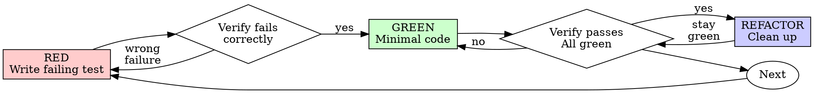

# typescript-tdd

## 概述

TypeScript + Vitest + Vite 项目的 TDD 工作流。

铁律：没有失败的测试之前，禁止写产品代码。已经写了产品代码，删除后从测试重新开始。

技术栈：Node.js 22+、pnpm 9+、Vite 5+、Vitest 0.34+（v8 覆盖率）。

本技能处理单元测试与 TDD 流程。集成测试、端到端测试、性能压测不属于本技能。

## 上下文层级

- 本文件常驻上下文，包含工作流、判定标准与验证命令。
- `references/tdd-best-practices.md`：RED/GREEN 验证细节、好测试特征、合理化借口、危险信号、验证清单。进入任一阶段前按需加载。
- `references/testing-anti-patterns.md`：写或改测试、添加 mock、在生产类上添加方法时加载。
- `references/framework-guide.md`：配置 Vitest、组织测试文件、编写纯函数与异步函数测试、生成覆盖率报告时加载。
- `references/ci-integration.md`：配置 GitHub Actions、覆盖率门禁或 CI 缓存时加载。
- `assets/sample_input.json`：脚本输入的字段示例。
- `package.json`、`vite.config.ts`、`vitest.config.ts`：开始前读取，确认测试命令、测试环境、路径别名与覆盖率配置。

## 使用时机

适用于新功能、Bug 修复、重构、行为变更、补测试、提升覆盖率、生成 mock/stub。

一次性原型、生成的代码、配置文件、端到端测试、性能压测、非 TypeScript 项目不进入 TDD 流程。用户明确要求跳过 TDD 时，说明未走 TDD 流程，并停止使用本技能。

## 编码四原则

1. 测试先行：先写能失败的测试，再确认它因功能缺失而失败。
2. 最小实现：只写让当前测试通过的最少代码。
3. 验证真实行为：断言业务结果，不断言 mock 是否被调用。
4. 保持绿色：每次改动后全部测试通过且输出干净。

## 流程

```text
RED ──→ 验证失败 ──→ GREEN ──→ 验证通过 ──→ REFACTOR ──→ 验证通过 ──→ 下一个
   ↑                                                           │
   └───────────────────────────────────────────────────────────┘
```



### 1. RED：写失败测试

写一个最小的测试，描述期望行为。

- 一个测试一个行为；名称含 “and” 时拆开。
- 测试名描述预期行为：`should<行为>_when<条件>`。
- 优先使用真实代码，mock 只在不可避免时使用。
- 测试文件放在与 `src` 同级的 `test` 目录，目录结构镜像 `src`。
- mock 测试命名 `*.mock.test.ts`，真实依赖测试命名 `*.real.test.ts`。
- 使用 `describe`、`it`、`expect` 组织测试。

```typescript
// test/utils/formatPrice.real.test.ts
import { describe, expect, it } from 'vitest';
import { formatPrice } from '../../src/utils/formatPrice';

describe('formatPrice', () => {
  it('shouldThrow_whenAmountIsNegative', () => {
    expect(() => formatPrice(-1, '¥')).toThrow('Amount must be non-negative');
  });
});
```

### 2. 验证 RED

没有亲眼看到测试失败，就无法确认测试测的是正确行为。

运行目标测试：

```bash
pnpm vitest run test/utils/formatPrice.real.test.ts
```

确认：

- 测试失败，而不是意外通过；编译失败也属于测试失败。
- 失败信息符合预期。
- 失败原因是功能缺失，而不是拼写或语法错误。

测试意外通过，说明测的是已存在行为，修改测试。测试报错，修正错误后重新运行，直到它正确地失败。

### 3. GREEN：最小实现

写能让测试通过的最少代码。不添加功能，不重构其他代码，不引入超出测试范围的改进。临时重复代码可以接受。

```typescript
// src/utils/formatPrice.ts
export const formatPrice = (amount: number, currency: string): string => {
  if (amount < 0) throw new Error('Amount must be non-negative');
  return `${currency}${amount.toFixed(2)}`;
};
```

### 4. 验证 GREEN

再次运行目标测试，确认：

- 测试通过。
- 其他测试依然通过。
- 输出干净，无 error、无 warning。

测试失败时修改代码，不修改测试。其他测试失败时立即修复。

### 5. REFACTOR：清理

测试通过后消除重复、改进命名、提取 helper。每次小重构后重新运行测试。

保持测试绿色，不添加行为。

### 6. 循环

完成一个 RED-GREEN-REFACTOR 循环再开始下一个。每次 GREEN 后提交。

## 代码分析

### 好测试的特征

| 质量 | 合格 | 不合格 |
|------|------|--------|
| 最小 | 一个测试一个行为 | `it('validates email and domain and whitespace')` |
| 清晰 | 名称描述行为 | `it('test1')` |
| 体现意图 | 展示期望的 API | 掩盖代码应该做什么 |
| 真实 | 断言业务结果 | 只断言 mock 被调用 |

### 依赖识别与 Mock

外部 IO 是 mock 候选：网络请求、文件系统、数据库、时间、随机数、第三方 SDK。纯函数与内存对象使用真实实现。

写 mock 之前回答三个问题：

1. 真实方法有什么副作用？
2. 测试是否依赖这些副作用？
3. 是否完全理解测试需要什么？

依赖副作用时，在更低层 mock 真正慢或外部的操作。不确定时，先用真实实现运行测试，观察实际需要，再在正确层级添加最小 mock。

```typescript
// 仅 mock 真正需要隔离的模块
vi.mock('../../src/api/user', () => ({
  fetchUsers: vi.fn().mockResolvedValue([{ id: '1', name: 'Alice' }]),
}));

beforeEach(() => {
  vi.clearAllMocks();
});
```

### 覆盖率阈值

| 类型 | 阈值 |
|------|------|
| 行覆盖率 | 80% 以上 |
| 分支覆盖率 | 75% 以上 |
| 函数覆盖率 | 90% 以上 |
| 关键路径（认证、支付、数据校验） | 100% |

覆盖率用于发现缺口，不替代行为断言。

### 缺陷修复

发现缺陷时，先写一个失败测试复现它，再走 RED-GREEN-REFACTOR 循环。测试同时证明修复有效并防止回归。不在没有测试的情况下修复缺陷。

RED：

```typescript
// test/form.real.test.ts
it('shouldReturnError_whenEmailIsEmpty', async () => {
  const result = await submitForm({ email: '' });
  expect(result.error).toBe('Email required');
});
```

验证 RED：

```bash
pnpm vitest run test/form.real.test.ts
# 失败：expected 'Email required', received undefined
```

GREEN：

```typescript
// src/form.ts
export const submitForm = async (data: FormData) => {
  if (!data.email?.trim()) return { error: 'Email required' };
  // ...
};
```

验证 GREEN：

```bash
pnpm vitest run test/form.real.test.ts
# 通过
```

REFACTOR：多个字段重复校验时，提取校验函数，并保持测试通过。

## 验证清单

完成工作前逐项确认：

- [ ] 每个新函数或方法都有测试
- [ ] 亲眼看过每个测试失败
- [ ] 每个测试因预期原因失败（功能缺失，不是笔误）
- [ ] 每个测试用最小代码通过
- [ ] 全部测试通过
- [ ] 输出干净，无 error、无 warning
- [ ] 测试使用真实代码，mock 只在不可避免时使用
- [ ] 边界场景与错误输入已覆盖
- [ ] 测试相互独立，不依赖执行顺序
- [ ] 未遗留 `.only`、`.skip`
- [ ] 覆盖率达标

任一项未完成，视为未完成 TDD，回到 RED。

完整清单见 `references/tdd-best-practices.md` 的 `验证清单`。

## 危险信号

出现以下任一情况，删除产品代码，从 RED 重新开始：

- 在测试之前写产品代码。
- 实现之后补测试。
- 测试立即通过。
- 说不清测试为什么失败。
- 说“以后再补测试”。
- 保留已写代码“作参考”，或让测试适配已有实现。
- 在生产代码中添加仅测试使用的方法或导出。
- 只验证 mock 调用，没有真实业务结果断言。
- 未理解依赖就添加 mock。
- 用 `console.log` 代替 `expect` 做验收。
- 测试之间共享可变状态或依赖执行顺序。
- 用 snapshot 代替行为断言。
- 为达到覆盖率而写无断言测试。
- 以“就这一次”“这次不一样”为由跳过 TDD。

完整危险信号见 `references/tdd-best-practices.md` 的 `危险信号`，mock 相关危险信号见 `references/testing-anti-patterns.md` 的 `危险信号`。

## 顺序为何重要

先写实现再补测试，测试会立即通过。立即通过无法证明：

- 测的是正确的东西；
- 测的是行为而不是实现；
- 覆盖了未预料的边界；
- 测试曾经捕获过缺陷。

测试先行强制观察失败，证明测试确实在验证某个行为。

删除已写代码不构成浪费。沉没成本已经发生，当前选择是：

- 删除后用 TDD 重写，耗时更长，结果可信；
- 保留代码再补测试，耗时更短，结果不可信，可能遗留缺陷。

未验证的代码是技术债，保留它才是浪费。

TDD 并不教条。测试先行在提交前发现缺陷，防止回归，记录行为，使重构可行。跳过测试等于把调试成本转移到生产环境。

## 理由辩解

| 常见理由 | 判断 |
|----------|------|
| 太简单，不需要测试 | 简单代码也会出错，写测试只需几十秒。 |
| 之后补测试 | 立即通过的测试无法证明它测的是正确行为。 |
| 已经手动测试过 | 手动验证无记录、不可重跑，也证明不了边界。 |
| 手动测试更快 | 手动测试证明不了边界，每次改动都要重测。 |
| 删除已写代码太浪费 | 保留未验证代码是技术债，沉没成本不构成保留理由。 |
| 保留代码作参考，先写测试 | 实际会去适配已有实现，等于后补测试。删除就是删除。 |
| 需要先探索方案 | 探索完成后丢弃探索代码，用 TDD 重新实现。 |
| 测试很难写 | 难测试通常意味着接口难使用，简化接口。 |
| TDD 太慢 | 测试先行比事后调试快，捷径会把成本转移到生产环境。 |
| 现有代码没有测试 | 为现有代码补测试，再修改行为。 |
| TDD 太教条 | TDD 是实用的，跳过测试等于在生产环境调试。 |

完整列表见 `references/tdd-best-practices.md` 的 `常见合理化借口`。

## 验证

按项目已有脚本执行，顺序如下：

```bash
# 类型检查
pnpm tsc --noEmit

# 运行目标测试
pnpm vitest run test/utils/formatPrice.real.test.ts

# 运行单个用例
pnpm vitest run test/utils/formatPrice.real.test.ts -t "shouldThrow_whenAmountIsNegative"

# 运行全部测试
pnpm test

# 生成覆盖率报告
pnpm vitest run --coverage
```

`package.json` 已定义对应脚本时，优先使用项目脚本。缺少 Vitest 时安装：

```bash
pnpm add -D vitest @vitest/coverage-v8
```

判定标准：

- RED 阶段：测试必须失败，且失败原因符合预期。
- GREEN 阶段：目标测试通过，其他测试通过，输出干净。
- REFACTOR 阶段：重构后所有测试保持通过。

## 实现检查表

- 测试文件位于 `test/`，目录结构镜像 `src/`。
- mock 测试文件命名 `*.mock.test.ts`，真实依赖测试命名 `*.real.test.ts`。
- 测试使用 `describe`、`it`、`expect`。
- 异步测试使用 `async` / `await`，不返回裸 Promise。
- mock 使用 `vi.fn()`、`vi.mock()`、`vi.spyOn()`。
- 测试之间调用 `vi.clearAllMocks()`；需要恢复 spy 的原始实现时调用 `vi.restoreAllMocks()`，或在配置中启用 `restoreMocks`。
- 时间相关逻辑使用 `vi.useFakeTimers()`，随机数使用 `vi.spyOn(Math, 'random')`。
- 环境变量在测试前设置，在 `afterEach` 中恢复。
- 测试数据由测试自己创建，不依赖外部数据库或已有文件。

## 输入要求

测试生成：

- TypeScript 源代码，文件路径或粘贴内容；
- 可选：覆盖范围（函数、模块、异步逻辑）。

覆盖率分析：

- 覆盖率报告，LCOV 或 JSON 格式；
- 可选：源代码文件路径；
- 可选：目标覆盖率阈值，默认 80%。

TDD 工作流：

- 功能需求或用户故事；
- 当前阶段：RED、GREEN、REFACTOR；
- 测试代码与实现状态。

## 限制

- 单元测试：集成测试与端到端测试需要不同模式，不在本技能范围。
- 静态分析：脚本不能运行测试，也不能测量运行时行为。
- 语言支持：TypeScript。
- 测试框架：Vitest。
- 覆盖率报告：LCOV、JSON。
- 测试生成：脚本输出测试桩，复杂逻辑需要人工审核。

## 参考资料

| 文件 | 内容 |
|------|------|
| `references/tdd-best-practices.md` | TDD 纪律、RED/GREEN 验证、借口与危险信号、验证清单 |
| `references/testing-anti-patterns.md` | 五类测试反模式、mock 门控函数、快速参考 |
| `references/framework-guide.md` | Vitest 配置、测试文件组织、纯函数、异步函数、mock、覆盖率输出 |
| `references/ci-integration.md` | GitHub Actions、覆盖率门禁、并行与缓存 |
| `assets/sample_input.json` | 脚本输入字段示例：源代码、需求、验收标准、覆盖率阈值 |

脚本依赖 `typer` 与 `rich`，统一使用以下前缀运行：

```bash
uv run --with typer --with rich python scripts/<script>.py <子命令> [参数]
```

| 脚本 | 用途 | 调用示例 |
|------|------|----------|
| `test_generator.py` | 从 TypeScript 源码生成 Vitest 测试桩，或分析函数结构 | `uv run --with typer --with rich python scripts/test_generator.py generate --input src/utils/formatPrice.ts --output test/utils/formatPrice.real.test.ts` |
| `coverage_analyzer.py` | 解析 LCOV/JSON 覆盖率报告，按 P0/P1/P2 排列缺口 | `uv run --with typer --with rich python scripts/coverage_analyzer.py analyze --report coverage/lcov.info --threshold 80` |
| `tdd_workflow.py` | 初始化、推进与校验 RED/GREEN/REFACTOR 阶段 | `uv run --with typer --with rich python scripts/tdd_workflow.py next --phase red --test test/utils/formatPrice.real.test.ts --impl src/utils/formatPrice.ts --state .tdd-state.json` |
| `fixture_generator.py` | 从 interface/type 生成夹具、边界值与 vi.fn() mock | `uv run --with typer --with rich python scripts/fixture_generator.py fixture --entity User --count 5 --source src/types.ts` |

补充用法：

- `test_generator.py analyze <源码文件>`：列出函数、参数、异常与分支数量。
- `coverage_analyzer.py summary <报告文件>`：输出覆盖率摘要。
- `tdd_workflow.py init --path <状态文件>`：初始化工作流状态。
- `tdd_workflow.py check --phase <red|green|refactor>`：输出阶段验证清单。
- `tdd_workflow.py report <状态文件>`：输出工作流执行报告。
- `fixture_generator.py edge --entity <名称> --source <类型文件>`：生成边界值数据。
- `fixture_generator.py mock --entity <名称> --source <类型文件>`：生成 `vi.fn()` mock 对象。
- `fixture_generator.py analyze <类型文件>`：列出可生成夹具的类型与属性。

`test_generator.py` 按源文件名生成相对 import；输出到 `test/` 镜像目录后，按实际相对路径修正 import。

脚本只做静态解析，不运行测试；生成的是测试桩，不等于测试。真正编写测试必须走本文的 TDD 流程。
