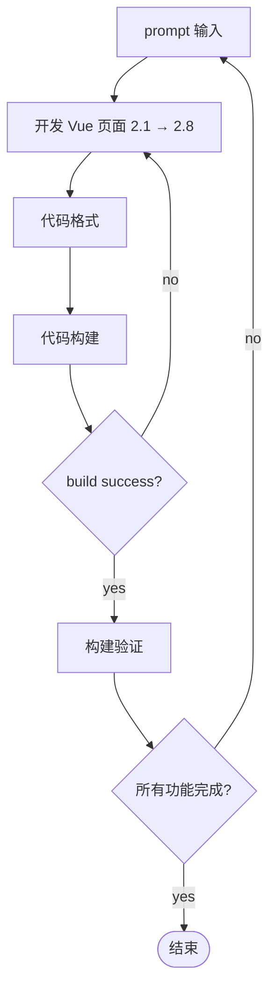

# vue-coder

## 概述

Vue 3 + TypeScript 项目的开发技能。按 PRD 解析 → 静态页面 → 数据模型 → mock 数据 → API 封装 → 业务逻辑 → 通用组件 → 页面组装 → 格式化 → 构建验证的顺序推进，以 `pnpm run build` 编译通过为完成标准。

技术栈固定：tdesign-vue-next（布局）、echarts + vue-echarts（图表）、TypeScript（类型）、Pinia（状态）、Axios（请求）。

## 上下文层级

按需加载，避免一次读入全部参考文档。

| 层级 | 内容 | 加载时机 |
|------|------|----------|
| 1 | 本文件 | 始终 |
| 2 | PRD 文档、UI HTML 设计稿 | 步骤 1，解析需求与布局 |
| 3 | 核心参考：vue-typescript-example、api-mock-data、vue-assembly-example、vue-component-patterns、api-integration、vue-state-management | 进入对应开发步骤时 |
| 4 | 组件与图表参考：`references/tdesign-component-*.md`、`references/echart-component-*.md` | 用到某个组件或图表时，按参考资料表格定位 |

项目源码按步骤读取，不预先通读整个 `src/`。

## 使用时机

适用：

- Vue 3 页面开发、管理后台、表单/表格/弹窗组件。
- 数据可视化与 ECharts 图表（11 种）。
- TypeScript 类型定义、Composition API、响应式数据。
- 现有页面改造、bug 修复、单元测试与覆盖率提升。
- 涉及 `.vue` 文件、组件开发等 Vue 3 概念的任务。

不适用：React、Angular、纯后端、与前端页面无关的脚本任务。

## 编码四原则

### 先思考再编码

- 明确陈述假设，不确定时提问。
- 存在多种解释时全部列出，不默默选择其一。
- 有更简单的方法直接说明。
- 遇到不清楚的地方停下来，指出困惑点。

### 简洁优先

- 不添加被要求之外的功能。
- 不为一次性代码创建抽象。
- 不添加未被要求的灵活性或可配置性。
- 不为不可能发生的场景编写错误处理。
- 200 行能压到 50 行时重写。

### 精准修改

- 只碰必须改的代码，不"改进"相邻代码、注释或格式。
- 不重构没有问题的部分，匹配现有风格。
- 发现无关死代码时指出，不删除。
- 移除因本次修改而失效的导入、变量或函数。

### 目标驱动

- 把"添加校验"转成"为无效输入编写测试并让其通过"。
- 把"修复 bug"转成"先复现问题，再修复"。
- 多步骤任务先列计划：`步骤 → 验证项`。

## 技术规范

### TypeScript

- 所有 `.vue` 的 `<script>` 加 `lang="ts"`。
- 禁止 `any`；确因无类型第三方库必须使用，加注释说明原因。其余场景用具体类型、`unknown` 或泛型。
- 对象结构优先 `interface`；联合类型、交叉类型、简单别名用 `type`。
- 为 API 响应、事件 payload 定义明确接口。
- 常量对象用 `as const`。
- 命名：变量与函数 camelCase，常量 UPPER_SNAKE_CASE，类/接口/枚举/类型 PascalCase，布尔值加 is/has/can/should 前缀。
- 函数一律用箭头函数。API 函数以 `Api` 结尾（如 `createUserApi`），业务处理函数以 `handle` 开头（如 `handleDialogOpen`），工具函数直接命名（如 `formatDate`）。
- `defineProps` 用泛型接口声明类型，禁止混用运行时声明与类型声明。
- `defineEmits` 用泛型声明事件名与参数类型。
- 简单响应式类型用 `ref` 自动推导；复杂对象用 `reactive<Interface>` 或 `ref<Interface>`。
- 自定义 Hook 明确声明返回值类型。
- 获取 UI 组件实例用 `InstanceType<typeof Component>`。

### 全局约束

| # | 约束 | 原因 |
|---|------|------|
| 1 | 布局只能用 `tdesign-vue-next` | 统一技术栈，禁止混用组件库 |
| 2 | 图表只能用 `echarts` 与 `vue-echarts` | 统一图表实现 |
| 3 | 使用 `<script setup lang="ts">` | 统一 Composition API 语法 |
| 4 | 禁止 `any` | 类型安全 |
| 5 | API 响应统一为 `{ code, displayMsg, data, uniqCode, msg }` | 前后端接口规范 |
| 6 | 包管理与构建命令一律用 `pnpm` | 项目统一包管理器 |
| 7 | 禁止执行 `pnpm run serve` | 以构建结果验证，不启动开发服务器 |

### 项目结构

```text
src/
├── api/                  # API 接口（models/ 数据结构 + 调用函数）
├── assets/               # 图片 / 全局样式 / JSON mock 数据
├── components/           # 通用业务组件
├── layouts/              # 布局框架
├── request/              # Axios 封装 + 拦截器
├── stores/               # Pinia 状态管理
├── styles/               # 全局 SCSS 变量
├── typings/              # TypeScript 类型声明
├── utils/                # 工具函数
├── views/                # 业务视图（按路由路径组织）
├── App.vue
└── main.ts               # 入口文件
```

### 组件规范

- 组件名 PascalCase，文件名 `PascalCase.vue`。
- Props 用 `defineProps` + TypeScript 接口，复杂 props 定义独立 interface。
- Emits 用具名元组：`defineEmits<{ update: [value: string] }>()`。
- 单个组件不超过 200 行。
- Props/Emits 示例见 [vue-component-patterns](references/vue-component-patterns.md)。

### 命名约定

| 类型 | 约定 | 示例 |
|------|------|------|
| 组件文件 | PascalCase.vue | `UserCard.vue` |
| Store 文件 | camelCase.ts | `useUserStore.ts` |
| API 文件 | camelCase.ts | `user.ts` |
| 工具函数 | camelCase.ts | `errorHandler.ts` |

### 反模式

- 在组件中直接调用 API。
- 跳过 mock 直接写交互。
- 滥用 provide/inject，优先 Pinia。
- 在模板中使用复杂表达式，应提取为 computed。
- 过度拆分组件。

## 流程



### 步骤 1：解析输入

- 从 prompt 解析 PRD 路径与 UI HTML 设计稿路径。
- 阅读 PRD 理解业务需求，阅读 UI 设计稿理解页面布局。
- 禁止在项目中备份 prompt、PRD、UI 文档。

### 步骤 2：开发 Vue 页面

#### 2.1 画静态 Vue 页面（必选）

- 文件内顺序固定为 `template` → `script` → `style`。
- 布局只用 `tdesign-vue-next`：`import { XXX } from 'tdesign-vue-next'`。
- 有图表需求时用 `echarts` + `vue-echarts`：`import { XXX } from 'echarts/charts'`、`import { XXX } from 'vue-echarts'`。
- 尽量在页面内直接 import 视图相关组件。
- 组件选型查下文[参考资料](#参考资料)的 TDesign 组件表。

产出：静态 `.vue` 页面。

#### 2.2 定义 API 数据模型（必选）

在 `src/api/models/<business name>.ts` 用 `declare namespace` 定义数据结构。

完整示例见 [vue-typescript-example](references/vue-typescript-example.md#定义数据模型)。

推荐：

1. 一个 `declare namespace` 一个 ts 文件。
2. 复用已存在的 namespace。
3. 可合并的业务概念合并。

禁止：

1. import `tdesign-vue-next` 或 `echarts` 组件。
2. 编写 `function` 或箭头函数。

产出：类型定义文件。

#### 2.3 数据 Mock（必选）

按 2.2 的模型创建 `src/assets/mocks/<module name>-<business name>.json`，业务调用函数 import 此 JSON。

完整示例见 [api-mock-data](references/api-mock-data.md)。

产出：JSON mock 文件。

#### 2.4 业务逻辑封装与数据调用（必选）

在 `src/api/<business name>-api.ts` 用箭头函数声明 API 函数，import 2.3 的 mock JSON。

完整示例见 [vue-typescript-example](references/vue-typescript-example.md#业务逻辑封装与数据调用)。

推荐：

1. 箭头函数声明。
2. 方法名动词开头（`get`/`list`/`page`/`create`/`update`/`delete`/`count`/`stat`），中间业务名词，`Api` 结尾，如 `createXxxYyyApi`。

禁止：

1. import `tdesign-vue-next` 或 `echarts` 组件。
2. 定义 `declare namespace`、`type`、`interface`。

产出：`src/api/xxxx-api.ts`。

#### 2.5 定义 view 数据模型（可选）

按需在 `src/views/<module name>/components/types/models.ts` 用 `declare namespace` 定义页面展示结构。

完整示例见 [vue-typescript-example](references/vue-typescript-example.md#定义数据模型)。

推荐：复用 2.2 的模型。

禁止：

1. import `tdesign-vue-next` 或 `echarts` 等视图组件。
2. 编写 `function` 或箭头函数。

产出：类型定义文件。

#### 2.6 Vue 组件业务逻辑封装（必选）

在 `src/views/<module name>/components/types/use<business name>.ts` 用箭头函数声明业务逻辑函数，调用 2.4 的 API 函数获取数据。

完整示例见 [vue-typescript-example](references/vue-typescript-example.md#业务逻辑封装与数据调用)。

推荐：

1. 箭头函数；方法以 `handle` 开头、业务名词结尾，如 `handleXxx`。
2. 复用 2.2 的模型。

禁止：

1. import `tdesign-vue-next` 或 `echarts` 等视图组件。
2. 定义 `declare namespace`、`type`、`interface`。

产出：`useXxx.ts`。

#### 2.7 封装通用组件（可选）

读取 `src/views/<module name>/*.vue`，把公共部分抽到 `src/views/<module name>/components/<component>.vue`。

适用对象：

1. 页面弹层。
2. 通用数据显示组件。
3. 需要 import `tdesign-vue-next` 与 `echarts` 的布局、显示组件。

产出：`components/*.vue`。

#### 2.8 页面组装与事件绑定（必选）

在 2.1 的 Vue 文件中引入 2.2 的数据模型与 2.4 的 API 函数，完成组装与事件绑定。

完整示例见 [vue-assembly-example](references/vue-assembly-example.md)。

要点：

- 类型从 `components/types/models.ts` 导入。
- 业务逻辑从 `components/types/useXxx.ts` 导入，组件内不直接写 API 调用。
- 事件处理函数统一 `handle` 前缀。

产出：完整的 `.vue` 页面组件。

### 步骤 3：代码格式

1. 清理本次改动后未使用的变量、函数、`declare namespace`、`interface`、`type`。
2. 执行：

```shell
pnpm run format
```

### 步骤 4：代码构建

```shell
pnpm run build
```

- 编译失败 → 修复错误 → 回到步骤 2。
- 编译通过 → 进入步骤 5。
- 禁止执行 `pnpm run serve`。

### 步骤 5：构建验证

- 核对 PRD 中未完成的功能点。
- 有遗漏 → 回到步骤 1，处理下一个功能点。
- 全部完成 → 结束。

## 验证清单

- [ ] PRD 的功能点全部实现。
- [ ] 布局只使用 tdesign-vue-next，图表只使用 echarts + vue-echarts。
- [ ] 每个功能点先有 mock JSON，再有交互逻辑。
- [ ] `.vue` 使用 `<script setup lang="ts">`，顺序为 template → script → style。
- [ ] 无 `any`，函数为箭头函数，命名前缀符合规范。
- [ ] 组件内无直接 API 调用。
- [ ] `pnpm run build` 通过，无编译错误。
- [ ] 未执行 `pnpm run serve`。

## 危险信号

出现以下任一情况，说明已偏离流程，立即纠正：

- 跳过 mock 直接写交互。
- 在 `.vue` 组件里直接写 fetch/axios 调用。
- 引入 tdesign-vue-next 以外的布局库，或 echarts 以外的图表库。
- 数据模型文件里出现 import 视图组件或函数定义。
- API 文件里出现 `declare namespace`、`type`、`interface`。
- 用 `any` 绕过类型检查。
- 执行 `pnpm run serve` 验证。
- 为了让 build 通过而删除或注释功能代码。

## 理由辩解

| 借口 | 纠正 |
|------|------|
| 先写交互，mock 后面再补 | mock 先行是固定步骤，先建 JSON 再写交互 |
| 用 element-plus 更快 | 布局限定 tdesign-vue-next |
| 图表用别的库更简单 | 限定 echarts + vue-echarts |
| 这个参数类型复杂，先用 any | 用具体类型、unknown 或泛型；确需 any 要注释 |
| 组件里直接调接口省一层 | 业务逻辑放 `useXxx.ts` 或 `xxx-api.ts` |
| 启动 serve 看效果更快 | 以 `pnpm run build` 为验证标准 |
| 顺手重构一下相邻代码 | 只改需求涉及的代码，无关问题只指出 |
| 多加一点配置以后能复用 | 不写推测性代码，一次性的不抽象 |

## 验证

1. 执行 `pnpm run format`。
2. 执行 `pnpm run build`，确认退出码为 0。
3. 逐项核对验证清单。
4. 有失败项则修复，重复 1–3。

## 实现检查表

| 步骤 | 产出 | 完成标志 |
|------|------|----------|
| 2.1 | `.vue` 静态页面 | 布局与设计稿一致 |
| 2.2 | `src/api/models/<business>.ts` | `declare namespace` 定义完成 |
| 2.3 | `src/assets/mocks/<module>-<business>.json` | mock 数据可被 import |
| 2.4 | `src/api/<business>-api.ts` | 箭头函数、`Api` 结尾 |
| 2.5 | `components/types/models.ts` | 仅在有展示模型需求时创建 |
| 2.6 | `components/types/useXxx.ts` | `handle` 前缀业务函数 |
| 2.7 | `components/*.vue` | 公共组件已抽取 |
| 2.8 | 页面组件 | 数据与事件绑定完成 |
| 3–4 | 构建结果 | `pnpm run build` 通过 |

## 参考资料

### 核心参考

| 文档 | 内容 | 何时阅读 |
|------|------|----------|
| [vue-typescript-example](references/vue-typescript-example.md) | 数据模型、API 封装示例 | 步骤 2.2、2.4、2.5、2.6 |
| [api-mock-data](references/api-mock-data.md) | API 返回结构与 mock 数据 | 步骤 2.3 |
| [vue-assembly-example](references/vue-assembly-example.md) | 页面组装与事件绑定 | 步骤 2.8 |
| [vue-component-patterns](references/vue-component-patterns.md) | 组件模式、Props/事件设计、性能 | 开发业务组件时 |
| [api-integration](references/api-integration.md) | RequestHttp、拦截器、错误处理 | 深入请求层时 |
| [vue-state-management](references/vue-state-management.md) | Pinia store、持久化 | 状态管理时 |
| [echart-component-chart-guide](references/echart-component-chart-guide.md) | 图表决策树、按需引入、优化 | 开发图表时 |

### TDesign 组件参考

先按类别锁定组件，再读取对应文档。

```text
用户需求
  ├── 基础展示 → Button / Link / Icon / Typography
  ├── 布局结构 → Layout / Grid / Space / Divider
  ├── 导航交互 → Affix / Anchor / BackTop / Breadcrumb / Dropdown / Menu / Pagination / Steps / StickyTool / Tabs
  ├── 数据输入 → AutoComplete / Cascader / Checkbox / ColorPicker / DatePicker / Form / Input / InputAdornment / InputNumber / TagInput / Radio / RangeInput / Select / SelectInput / Slider / Switch / Textarea / Transfer / TimePicker / TreeSelect / Upload
  ├── 数据展示 → Avatar / Badge / Calendar / Card / Collapse / Comment / Descriptions / Empty / Image / ImageViewer / List / Loading / Progress / QRCode / Rate / Skeleton / Statistic / Swiper / Table / Tag / Timeline / Tooltip / Tree / Watermark
  ├── 反馈 → Alert / Dialog / Drawer / Guide / Message / Notification / Popconfirm / Popup
  └── 高级场景 → Chat（AI 对话）
```

| 组件 | 参考文档 | 触发场景 |
|------|----------|----------|
| Affix | [tdesign-component-affix](references/tdesign-component-affix.md) | 固定定位、吸顶导航 |
| Anchor | [tdesign-component-anchor](references/tdesign-component-anchor.md) | 锚点导航、目录跳转 |
| AutoComplete | [tdesign-component-autocomplete](references/tdesign-component-autocomplete.md) | 输入补全建议 |
| Avatar | [tdesign-component-avatar](references/tdesign-component-avatar.md) | 用户头像展示 |
| BackTop | [tdesign-component-backtop](references/tdesign-component-backtop.md) | 回到顶部按钮 |
| Badge | [tdesign-component-badge](references/tdesign-component-badge.md) | 未读消息数、状态提示 |
| Breadcrumb | [tdesign-component-breadcrumb](references/tdesign-component-breadcrumb.md) | 面包屑导航路径 |
| Button | [tdesign-component-button](references/tdesign-component-button.md) | 按钮操作、提交、取消 |
| Calendar | [tdesign-component-calendar](references/tdesign-component-calendar.md) | 日期和日程展示 |
| Card | [tdesign-component-card](references/tdesign-component-card.md) | 相关内容卡片容器 |
| Cascader | [tdesign-component-cascader](references/tdesign-component-cascader.md) | 多级联动选择 |
| Chat | [tdesign-component-chat](references/tdesign-component-chat.md) | AI 对话交互界面 |
| Checkbox | [tdesign-component-checkbox](references/tdesign-component-checkbox.md) | 多选框、分组全选 |
| Collapse | [tdesign-component-collapse](references/tdesign-component-collapse.md) | 折叠面板展开收起 |
| ColorPicker | [tdesign-component-colorpicker](references/tdesign-component-colorpicker.md) | 颜色值选择 |
| Comment | [tdesign-component-comment](references/tdesign-component-comment.md) | 评论反馈内容展示 |
| DatePicker | [tdesign-component-datepicker](references/tdesign-component-datepicker.md) | 日期范围选择 |
| Descriptions | [tdesign-component-descriptions](references/tdesign-component-descriptions.md) | 信息键值对展示 |
| Dialog | [tdesign-component-dialog](references/tdesign-component-dialog.md) | 模态对话框交互 |
| Divider | [tdesign-component-divider](references/tdesign-component-divider.md) | 内容区域分割线 |
| Drawer | [tdesign-component-drawer](references/tdesign-component-drawer.md) | 侧边滑出面板 |
| Dropdown | [tdesign-component-dropdown](references/tdesign-component-dropdown.md) | 下拉菜单选项 |
| Empty | [tdesign-component-empty](references/tdesign-component-empty.md) | 无数据空状态展示 |
| Form | [tdesign-component-form](references/tdesign-component-form.md) | 表单数据收集和校验 |
| Grid | [tdesign-component-grid](references/tdesign-component-grid.md) | 24 列栅格布局 |
| Icon | [tdesign-component-icon](references/tdesign-component-icon.md) | 图标展示旋转动画 |
| Image | [tdesign-component-image](references/tdesign-component-image.md) | 图片懒加载展示 |
| ImageViewer | [tdesign-component-imageviewer](references/tdesign-component-imageviewer.md) | 图片预览缩放旋转 |
| Input | [tdesign-component-input](references/tdesign-component-input.md) | 单行文本输入 |
| InputAdornment | [tdesign-component-inputadornment](references/tdesign-component-inputadornment.md) | 输入框前后缀装饰 |
| InputNumber | [tdesign-component-inputnumber](references/tdesign-component-inputnumber.md) | 数字输入增减按钮 |
| Layout | [tdesign-component-layout](references/tdesign-component-layout.md) | 页面布局框架结构 |
| Link | [tdesign-component-link](references/tdesign-component-link.md) | 文本超链接 |
| List | [tdesign-component-list](references/tdesign-component-list.md) | 数据集合列表展示 |
| Loading | [tdesign-component-loading](references/tdesign-component-loading.md) | 加载状态展示 |
| Menu | [tdesign-component-menu](references/tdesign-component-menu.md) | 导航菜单选项 |
| Message | [tdesign-component-message](references/tdesign-component-message.md) | 轻量级操作反馈 |
| Notification | [tdesign-component-notification](references/tdesign-component-notification.md) | 系统通知重要信息 |
| Pagination | [tdesign-component-pagination](references/tdesign-component-pagination.md) | 分页控件 |
| Popconfirm | [tdesign-component-popconfirm](references/tdesign-component-popconfirm.md) | 气泡确认框 |
| Popup | [tdesign-component-popup](references/tdesign-component-popup.md) | 弹出层基础组件 |
| Progress | [tdesign-component-progress](references/tdesign-component-progress.md) | 操作进度展示 |
| QRCode | [tdesign-component-qrcode](references/tdesign-component-qrcode.md) | 二维码生成 |
| Radio | [tdesign-component-radio](references/tdesign-component-radio.md) | 单选框分组按钮 |
| RangeInput | [tdesign-component-rangeinput](references/tdesign-component-rangeinput.md) | 数值范围输入 |
| Rate | [tdesign-component-rate](references/tdesign-component-rate.md) | 打分评价 |
| Select | [tdesign-component-select](references/tdesign-component-select.md) | 下拉单选多选 |
| SelectInput | [tdesign-component-selectinput](references/tdesign-component-selectinput.md) | 带下拉输入框 |
| Skeleton | [tdesign-component-skeleton](references/tdesign-component-skeleton.md) | 加载占位骨架屏 |
| Slider | [tdesign-component-slider](references/tdesign-component-slider.md) | 数值范围滑块 |
| Space | [tdesign-component-space](references/tdesign-component-space.md) | 组件间距设置 |
| Statistic | [tdesign-component-statistic](references/tdesign-component-statistic.md) | 关键指标展示 |
| Steps | [tdesign-component-steps](references/tdesign-component-steps.md) | 步骤流程指示 |
| StickyTool | [tdesign-component-stickytool](references/tdesign-component-stickytool.md) | 吸附工具栏 |
| Swiper | [tdesign-component-swiper](references/tdesign-component-swiper.md) | 循环轮播展示 |
| Switch | [tdesign-component-switch](references/tdesign-component-switch.md) | 双状态开关切换 |
| Table | [tdesign-component-table](references/tdesign-component-table.md) | 数据表格排序筛选 |
| Tabs | [tdesign-component-tabs](references/tdesign-component-tabs.md) | Tab 页签切换 |
| Tag | [tdesign-component-tag](references/tdesign-component-tag.md) | 标记分类状态 |
| TagInput | [tdesign-component-taginput](references/tdesign-component-taginput.md) | 标签创建删除编辑 |
| Textarea | [tdesign-component-textarea](references/tdesign-component-textarea.md) | 多行文本输入 |
| Timeline | [tdesign-component-timeline](references/tdesign-component-timeline.md) | 事件时间轴展示 |
| TimePicker | [tdesign-component-timepicker](references/tdesign-component-timepicker.md) | 时间选择 |
| Tooltip | [tdesign-component-tooltip](references/tdesign-component-tooltip.md) | 悬停说明文字 |
| Transfer | [tdesign-component-transfer](references/tdesign-component-transfer.md) | 双向面板穿梭 |
| Tree | [tdesign-component-tree](references/tdesign-component-tree.md) | 层级树形数据 |
| TreeSelect | [tdesign-component-treeselect](references/tdesign-component-treeselect.md) | 树形下拉选择器 |
| Typography | [tdesign-component-typography](references/tdesign-component-typography.md) | 统一文本样式排版 |
| Upload | [tdesign-component-upload](references/tdesign-component-upload.md) | 文件拖拽批量上传 |
| Watermark | [tdesign-component-watermark](references/tdesign-component-watermark.md) | 页面水印标记 |
| Alert | [tdesign-component-alert](references/tdesign-component-alert.md) | 提示信息提醒 |

### ECharts 图表参考

| 图表类型 | 参考文档 |
|---------|---------|
| 折线图/面积图 | [LineChart](references/echart-component-linechart.md) |
| 柱状图 | [BarChart](references/echart-component-barchart.md) |
| 饼图/环形图 | [PieChart](references/echart-component-piechart.md) |
| 散点图/气泡图 | [ScatterChart](references/echart-component-scatterchart.md) |
| 雷达图 | [RadarChart](references/echart-component-radarchart.md) |
| 仪表盘 | [GaugeChart](references/echart-component-gaugechart.md) |
| 热力图 | [HeatmapChart](references/echart-component-heatmapchart.md) |
| 漏斗图 | [FunnelChart](references/echart-component-funnelchart.md) |
| 树形图 | [TreemapChart](references/echart-component-treemapchart.md) |
| 桑基图 | [SankeyChart](references/echart-component-sankeychart.md) |
| K 线图 | [CandlestickChart](references/echart-component-candlestickchart.md) |
